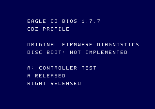

# EagleBIOS-CD 1.7.7 diagnostic gate results — 2026-10-21

**F1 emulator diagnostic passed. Disc boot / complete replacement BIOS not delivered.**
Source is the same preserved baseline recorded in the [CD audit](EAGLEBIOS_CD_AUDIT.md).
No proprietary BIOS code/assets or emulator implementation were copied.

## Reproducible original ROMs

```sh
python3 bios/cd/tools/build.py --out /home/kepler/neogeosdk-cd-20261021/firmware-f1
python3 bios/cd/tools/qa.py \
  --firmware /home/kepler/neogeosdk-cd-20261021/firmware-f1 \
  --model cdz --out /home/kepler/neogeosdk-cd-20261021/qa-firmware-f1-cdz-3
```

The same probe was run with `front` and `top`, each in its own new directory.
The native Windows build to `out/neocd/windows-validation/firmware/` reproduced
all three ROMs byte for byte. Each image is exactly 524,288 bytes, initial reset
signature `$0010F300`, reset PC `$C01000`, identity `$C00700`, capability 1
(diagnostics only). ELF/link maps and service-slot assertions accompany builds.

| Profile | SHA-256 |
|---|---|
| front | `29916bbe204cd1abe7101015a61088fbff2ee2aacdbeee8cd2a1db1790d9b87a` |
| top | `9d6179a6aea8d1a6684556784cd55150a1fb643f71d2ce034c758216ac929eb8` |
| cdz | `d1ca7345c6416b6ea8ac7761c34069d3cefb4acc219c5d767ff54c53e6494652` |

## Model matrix

| Configuration | Menu/FIX/palette | A + Right / frame clock | Disc/TOC/read | IPL/game boot | Reload/CDDA/save | Physical |
|---|---|---|---|---|---|---|
| MAME 0.264 `neocd -bios front` | PASS | PASS, mask 24, 235 frames | not implemented | not implemented | not implemented | not tested |
| MAME 0.264 `neocd -bios top` | PASS | PASS, mask 24, 235 frames | not implemented | not implemented | not implemented | not tested |
| MAME 0.264 `neocdz -bios official` with our private mapping | PASS | PASS, mask 24, 235 frames | not implemented | not implemented | not implemented | not tested |

The conventional MAME filename/selection is only a private test mapping; it
does not relabel our ROM as vendor firmware. Every test dumped and compared all
512 KiB actually mapped at `$C00000`, checked monotonic frame count and ROM/stack
bounds, and captured `menu.png`, `input.png`, `probe.csv`, `result.json`, logs
and the original mapped ROM. Results are under
`/home/kepler/neogeosdk-cd-20261021/qa-firmware-f1-{front,top,cdz}-3/`.



## Gates

| Gate | Result |
|---|---|
| F0 audit/toolchain/cartridge preservation | PASS for inspected boundaries |
| F1 original firmware, input/IRQ/watchdog diagnostic | PASS in the three emulator configurations above |
| F2 bounded drive bring-up, TOC, sector/invalid-media tests | NOT IMPLEMENTED |
| F3 IPL parsing/upload and native disc boot | NOT IMPLEMENTED |
| F4 runtime UPLOAD/LOADFILE/LOADFILEX/CDDA conformance | NOT IMPLEMENTED; reserved calls return unsupported |
| F5 original system audio, virtual card/cold restart | NOT IMPLEMENTED; no saves touched |
| F6 full cross-model F1–F5 | PENDING; cartridge AES/MVS baseline probes separately PASS |
| F7 physical testing/external compatibility | NOT TESTED / not authorized in this run |

MAME's optical model limitations and secondary HLE behavior do not count as
physical evidence. The separate native HLE hello-world capture is not execution
through this firmware. No alternate firmware is substituted to pass its gates.

Next firmware work must begin at F2: exact serial/CDC/IRQ contract, TOC and a
bounded synthetic sector-read path with media/lid errors; then implement the
ISO/IPL loader and game scheduling before advertising disc boot. Save format,
power-failure behavior, CDDA and reset recovery each need their own tests.
No firmware was flashed, published, committed or installed over cartridge ROMs.
