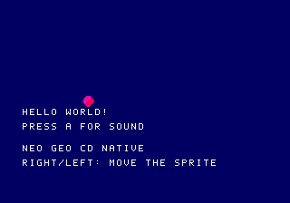

# Native CD implementation run — 2026-10-21

**Partial implementation; required stock boot gate blocked. No release approval.**

## Source and isolation

Branch `fix/maiya-arenas-eagle-bios`; local/upstream/remote/PR 9 commit
`8cb21a9b23252112a8a2c0a1f8a56f30a3638aef`. Existing dirty game/SDK work was
preserved. CD work adds `sdk/platform/`, `tools/neocd/`, `bios/cd/`, CD tests
and docs, plus an early CD selector around unchanged cartridge Makefile bodies.
No existing game source or installed cartridge folder/launcher was edited.
No commit, push, publication, identity or branch operation was performed.

Development evidence root on this machine:
`/home/kepler/neogeosdk-cd-20261021/`. It is not a portable SDK dependency.
Portable reproduction commands are in [the guide](../NEOGEO_CD.md).

## Exact builds

```sh
make PLATFORM=cd GAME=helloworld CD_BUILD_DIR=/home/kepler/neogeosdk-cd-20261021/hello-final cd-image
make PLATFORM=cd GAME=helloworld USE_2D_PLUS=1 CD_BUILD_DIR=/home/kepler/neogeosdk-cd-20261021/hello-plus-final cd-image
```

Native Windows CMD equivalents were run with `MakefileWin32.mak`, producing
`out/neocd/windows-validation/hello-c-final/` and `hello-plus-final/`. C and
C++14 here refer to the unchanged hello-world game/common FIX translation
units, not a complete CD port of the scene engine. All four configurations
produced byte-identical native payloads and ISO.

| File | Bytes | SHA-256 |
|---|---:|---|
| `disc/helloworld.iso` | 561,152 | `6345cef0c334953b9b5eff882578ede1dbe5d7d232a6a8da47a297ce015deef0` |
| `payload/HELLO.PRG` | 3,070 | `b071bbc1b770e995b259fcededcdd35fa36a9a71ee069d043bb65e45a51c7211` |
| `payload/FONT.FIX` | 131,072 | `feca1c2515473c34be89b76b45f01ec4e55a0325fe06c732b357982d047e0b96` |
| `payload/BOOT.SPR` | 256 | `72c13228b457021637f416243acd688ad2b2890c4b92944c35a12d5f333dc3b6` |
| `payload/SOUND.Z80` | 65,536 | `d3dfcc7c27390cfd86a1d177fd49a776d4b2707ea454430014cf6a4b579516ce` |
| `payload/CUE.PCM` | 4,096 | `8d8c339481f157ca97e253d16aaa0f9aa64e54eb5ff8a5478ee8bf91ff27b33e` |
| `payload/SCENE2.SPR` | 128 | `dc8a73fc7c927666d4a62c98608ee7ebb00a7fd004252633efacdda8c0098528` |
| `disc/audio/track02.wav` | 705,644 | `5bd1a5d6275d0622bd9885646153318df588bc966c95a9fc0b1585ace09dee49` |

The disc directory has its own `manifest.json`, `memory-map.json`, IPL listing
and `checksums.sha256`; no BIOS is included. CDDA audio data is 176,400 stereo
sample frames / 300 sectors / 705,600 PCM bytes. Firmware sizes/hashes are in
[the independent firmware report](EAGLEBIOS_CD_VALIDATION_REPORT.md).

## Tests and evidence

| Test | Result | Evidence under development root |
|---|---|---|
| `make cd-unit-tests` | PASS, 29 tests | `cd-unit-tests-final2.log` |
| Native C / C++14 builds | PASS | `hello-final.log`, `hello-plus-final.log` |
| Native Windows C / C++14 | PASS; exact payload/ISO parity | `windows-hello-c-final.log`, `windows-hello-plus-final.log`, `final-artifact-report.json` |
| Independent xorriso 1.5.6 extraction | PASS; every IPL payload exact | `xorriso-final.log`, `independent-extract-final/` |
| chdman 0.264 create/verify/extract | PASS; ISO and audio bytes exact | `chd-*-final.log`, `hello-final/extracted.*` |
| Original host C/C++/genre tests | PASS in isolated baseline | `baseline-host-tests.log` |
| Existing AES/MVS BIOS contract | PASS in Linux MAME 0.264 | `baseline-bios-probe-2.log`, `baseline-bios-probe-2/` |
| Cartridge preservation | PASS, 17 protected source/body hashes; AES/MVS recipe dry runs identical | `cartridge-source-preservation.json`, `cart-*-before.txt`, `cart-*-after.txt` |
| Stock CD smoke test | BLOCKED: no user-supplied recognized BIOS | `stock-qa-blocked.log`; no test directory created |
| Secondary NeoCD HLE diagnostic | PASS diagnostic only | `hle-qa-accepted/result.json`, `frame-*.png`, `audio.wav`, `core.log` |
| Actual original CD firmware | F1 only, independent report | `qa-firmware-f1-{front,top,cdz}-3/` |
| Physical CD/front/top/CDZ | NOT TESTED | no boards attached / no physical operations |

The unit suite covers IPL formatting/counts/byte-lane offsets; ISO endian
copies, directory bounds and overlaps; CUE track association and path safety;
CDDA format/truncation; every sprite half/plane fixture; FIX columns; C and
C++14 range/ABI tests; input edge persistence; native build/header integrity;
manifest dependency/residency safety; executable-overlay rejection; and original
firmware vectors, identity and exact service addresses. No empty save/overlay
implementation tests were added as a substitute for features that do not exist.

The successful HLE command was:

```sh
python3 tools/neocd/qa_libretro.py --hle-debug \
  --core /home/kepler/neogeosdk-cd-20261021/reference/neocd_libretro/neocd_libretro.so \
  --build /home/kepler/neogeosdk-cd-20261021/hello-final \
  --out /home/kepler/neogeosdk-cd-20261021/hle-qa-accepted
```

External core source `b1e04c738cb48a1dae0574b8877f6a116d270ca1`; binary SHA-256
`ee44287d11f5420c178eaa56cd39fe7e21acebf7a4ef4bfe624363a8b320ae6e`.
It explicitly used its built-in HLE, not stock or Eagle firmware. Native game
clock reached 894 frames; A/Right mask 24; sprite x moved 32→90. The captured
ADPCM-A cue peaked at 5,580; pre-button peak was zero. Native video was inspected.
`stock_gate_passed` and `eagle_gate_passed` remain false. Screenshot:



## Memory, audio and limitations

ELF: 3,064 bytes text/header/constant data, 6 initialized-data bytes, 2,572 BSS
bytes. PRG is resident below the 512 KiB linker limit; work starts `$100800`.
Boot sprite use is 256/1,048,576 bytes in bank 0; scene 2 is 128 bytes in bank 1
and has not been loaded at runtime. FIX 131,072/131,072; PCM 4,096/1,048,576;
Z80 65,536/65,536. Save memory is untouched. Executable overlays are rejected.

The HLE effect capture is the only CD-runtime audio execution evidence. The
authored CDDA track passed format/container round trips but was not played by
the CD runtime. FM/SSG, ADPCM-B fallback, simultaneous music/SFX, audio around
loads, persistence and actual optical latency remain unverified/unimplemented.

Two startup defects were found and fixed during diagnostics: VBlank must chain
to BIOS completion for USER scheduling, and game-owned input edges must survive
firmware's second poll. Earlier blank/silent diagnostics remain in private logs;
only the accepted run above is claimed as passing.

## Gate disposition and smallest next work

- Phase 0/F0 audit and cartridge baseline: complete for this run.
- Phase 1 native media/build: passes format/build/secondary diagnostic checks;
  **stock boot gate blocked**, so stable CD-platform acceptance is not granted.
- Phases 2–7: no completion claim. Implement/test loaders and scene invalidation,
  then CDDA plus concurrent SFX, transactional saves/cold restart, tutorial/demo
  and opt-in per-game feasibility in order after the stock gate.
- Firmware F1: passes; F2–F7 remain pending as separately documented.
- No release ROM was overwritten; no candidate was installed into hardware or
  the existing cartridge test folder. SDK full CD support is not declared.

First unblocker is a recognized, lawfully supplied CD BIOS file for `cd-test`.
Then inspect actual stock video/input/upload behavior and negative failure
paths before enabling raw BIOS I/O. Firmware F2 requires its own original drive
state machine, TOC/sector/media-error probes and per-model evidence.

`git diff --check` on the added CRLF Windows selector flags CR bytes as generic
trailing whitespace. A read-only CRLF-aware check uses
`git -c core.whitespace=blank-at-eol,blank-at-eof,space-before-tab,cr-at-eol diff --check`;
the original Windows file/body retains CRLF, with no line-ending conversion or
Git configuration changes. A final scoped diff/stat is captured in the evidence
root. Generated builds/references remain outside tracked source.
